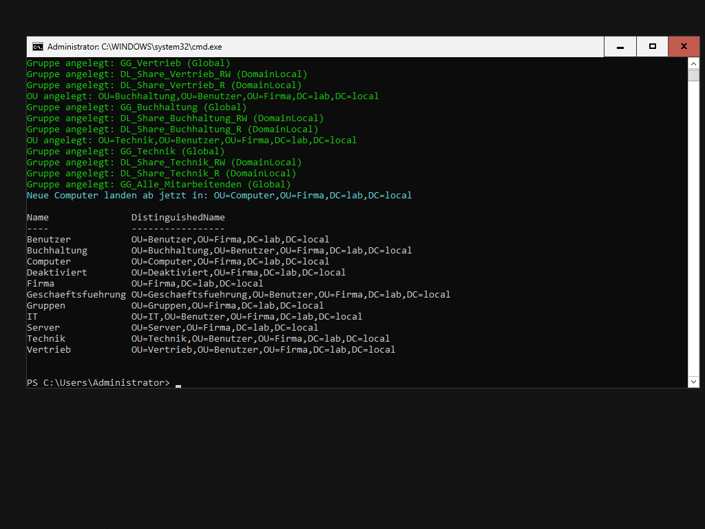
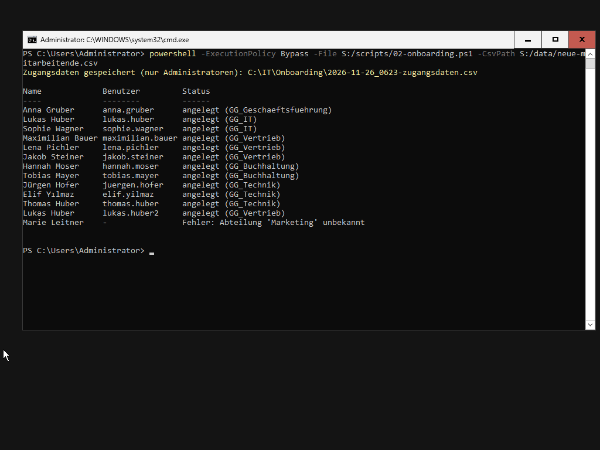

# IT-Homelab: Windows-Domäne für eine kleine Firma

Nachbau der IT einer Firma mit rund 20 Mitarbeitenden: Active Directory, Arbeitsplatz-Bereitstellung per PowerShell, Linux-Dateiserver in der Domäne, Helpdesk mit Inventar und ein Betriebshandbuch.

## Aufbau

| VM | System | RAM | IP | Rolle |
|---|---|---|---|---|
| DC01 | Windows Server 2025 Core | 2 GB | 10.10.10.10 | Domänencontroller, DNS, Gruppenrichtlinien |
| CL01 | Windows 11 Enterprise | 4 GB | DHCP/fest | Arbeitsplatz für Bereitstellungstests |
| LNX01 | Ubuntu Server 24.04 | 2 GB | 10.10.10.20 | Samba-Dateiserver, GLPI (Helpdesk + Inventar) |

Netz: VirtualBox-NAT-Netzwerk `LabNAT`, 10.10.10.0/24, Gateway 10.10.10.1. Domäne: `lab.local` (NetBIOS `LAB`).

## Stand

- [x] DC01 installiert (Server Core), feste IP, Domäne `lab.local` angelegt
- [x] OU-Struktur, Abteilungs- und Berechtigungsgruppen nach AGDLP ([01-ad-struktur.ps1](scripts/01-ad-struktur.ps1))
- [x] Onboarding-Skript: neue Mitarbeitende aus CSV anlegen ([02-onboarding.ps1](scripts/02-onboarding.ps1))
- [ ] Gruppenrichtlinien: Netzlaufwerk, Passwortrichtlinie, Sperrbildschirm
- [ ] CL01 in die Domäne aufnehmen
- [ ] LNX01: Samba als Domänenmitglied, Abteilungsfreigaben
- [ ] GLPI: Tickets, Inventar über Agent, Wissensdatenbank
- [ ] Teil der Infrastruktur per Terraform

## Struktur im Active Directory

```
lab.local
└── Firma
    ├── Benutzer
    │   ├── Geschaeftsfuehrung
    │   ├── IT
    │   ├── Vertrieb
    │   ├── Buchhaltung
    │   └── Technik
    ├── Computer      (Standardziel für neue Computer, per redircmp)
    ├── Server
    ├── Gruppen       (GG_* global, DL_Share_* domänenlokal)
    └── Deaktiviert   (ausgeschiedene Mitarbeitende)
```

Berechtigungen folgen AGDLP: Konto → globale Abteilungsgruppe `GG_<Abteilung>` → domänenlokale Gruppe `DL_Share_<Abteilung>_RW` → Freigabe. Ein neuer Mitarbeiter bekommt dadurch nur eine Gruppenmitgliedschaft, die Rechte ergeben sich daraus.



## Onboarding neuer Mitarbeitender

Die Personalabteilung liefert eine CSV-Datei ([Beispiel](data/neue-mitarbeitende.csv)) mit Vorname, Nachname, Abteilung, Funktion und Eintrittsdatum.

```powershell
.\scripts-onboarding.ps1 -CsvPath .\data
eue-mitarbeitende.csv -WhatIf   # Probelauf
.\scripts-onboarding.ps1 -CsvPath .\data
eue-mitarbeitende.csv
```

Das Skript

- bildet den Benutzernamen `vorname.nachname`, schreibt Umlaute und Sonderzeichen um (Jürgen → `juergen`, Yılmaz → `yilmaz`) und nummeriert Duplikate (`lukas.huber2`),
- legt das Konto in der OU der Abteilung an und setzt Abteilung, Funktion und Firma,
- nimmt es in `GG_<Abteilung>` auf, womit die Rechte auf die Abteilungsfreigabe automatisch folgen,
- vergibt ein zufälliges Startpasswort (kryptografischer Zufall, alle vier Zeichenklassen), das bei der ersten Anmeldung geändert werden muss,
- speichert die Zugangsdaten nur auf dem Server unter `C:\IT\Onboarding`, lesbar nur für Administratoren,
- überspringt Zeilen mit unbekannter Abteilung und meldet sie, statt abzubrechen.



