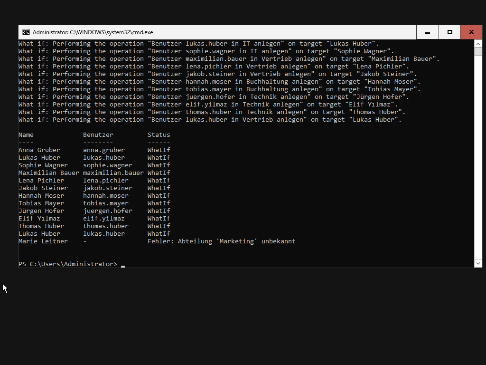
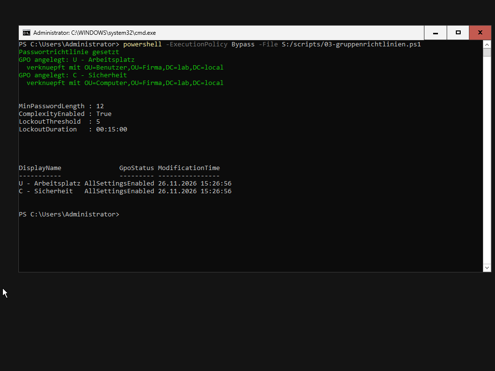
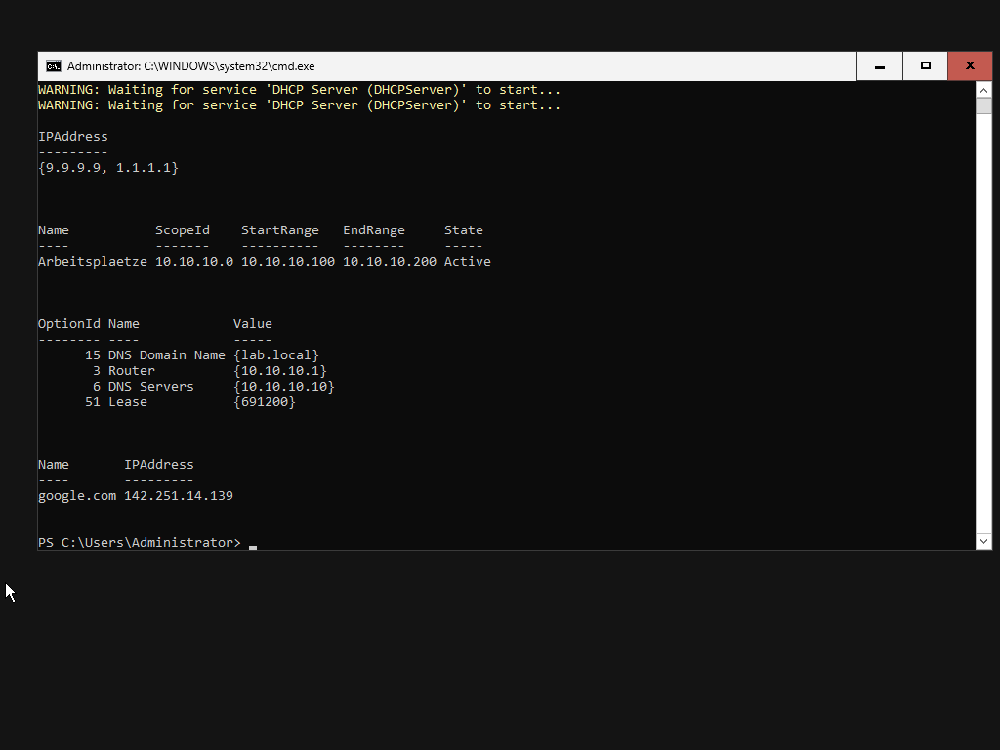
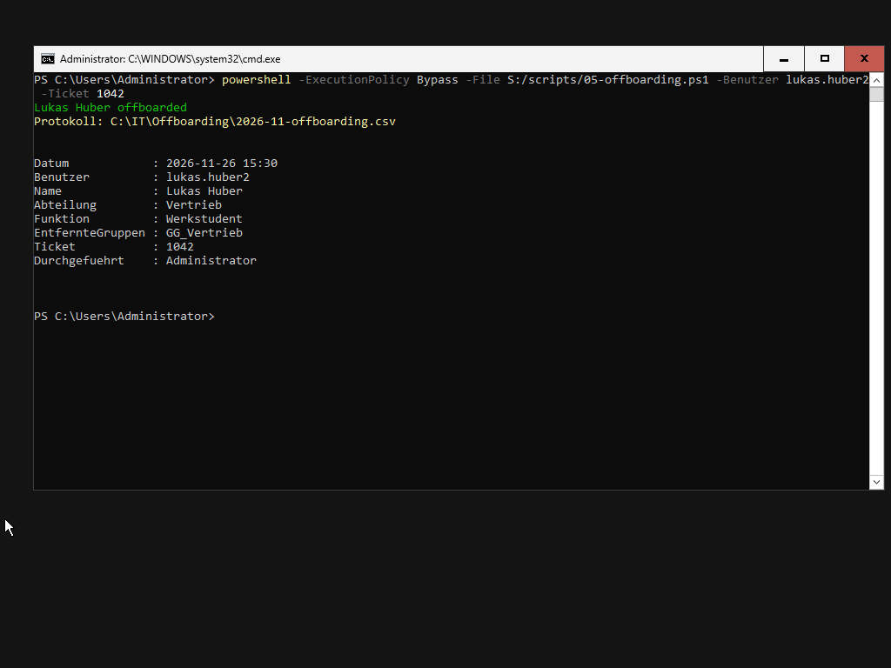
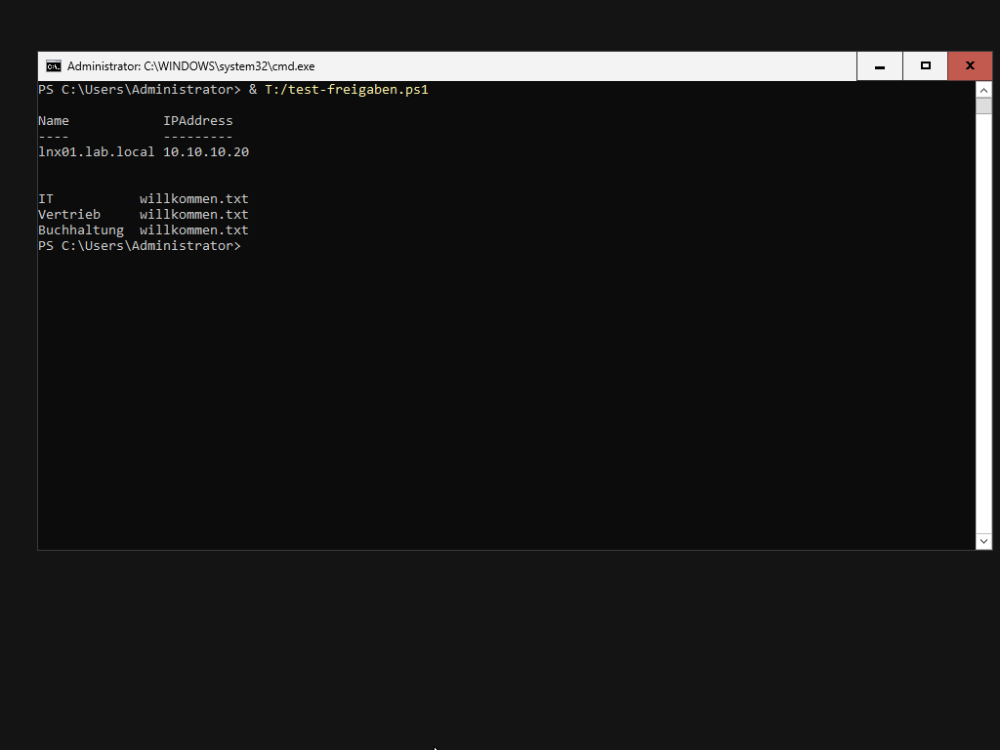
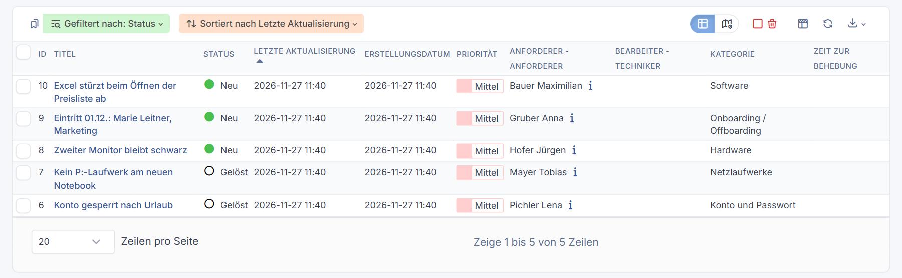
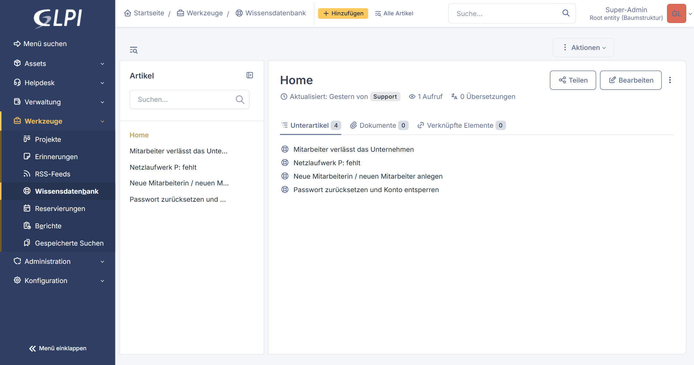
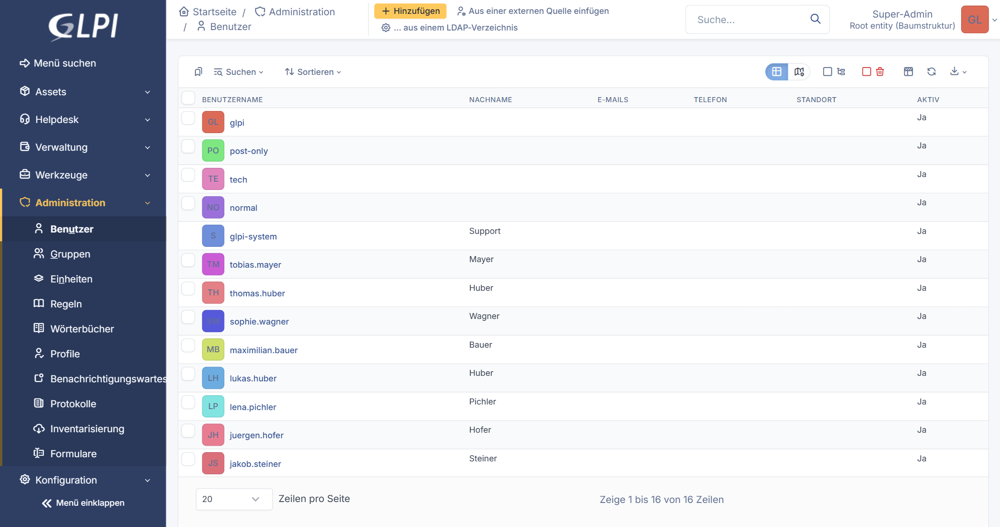
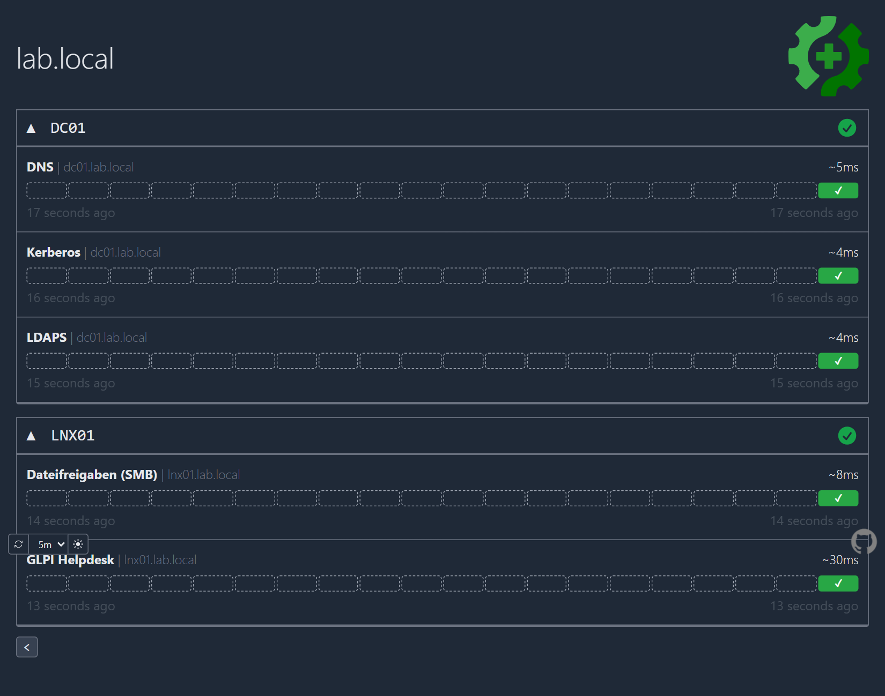

# IT-Homelab: Windows-Domäne für eine kleine Firma

Nachbau der IT einer Firma mit rund 20 Mitarbeitenden: Active Directory, Arbeitsplatz-Bereitstellung per PowerShell, Linux-Dateiserver in der Domäne, Helpdesk mit Inventar und ein Betriebshandbuch.

## Aufbau

| VM | System | RAM | IP | Rolle |
|---|---|---|---|---|
| DC01 | Windows Server 2025 Core | 2 GB | 10.10.10.10 | Domänencontroller, DNS, Gruppenrichtlinien |
| CL01 | Windows 11 Enterprise | 4 GB | DHCP/fest | Arbeitsplatz für Bereitstellungstests |
| LNX01 | Ubuntu Server 24.04 | 2 GB | 10.10.10.20 | Samba-Dateiserver, GLPI (Helpdesk + Inventar) |

Netz: VirtualBox-NAT-Netzwerk `LabNAT`, 10.10.10.0/24, Gateway 10.10.10.1. Domäne: `lab.local` (NetBIOS `LAB`).

## Stand

- [x] DC01 installiert (Server Core), feste IP, Domäne `lab.local` angelegt
- [x] OU-Struktur, Abteilungs- und Berechtigungsgruppen nach AGDLP ([01-ad-struktur.ps1](scripts/01-ad-struktur.ps1))
- [x] Onboarding-Skript: neue Mitarbeitende aus CSV anlegen ([02-onboarding.ps1](scripts/02-onboarding.ps1))
- [x] Passwortrichtlinie und Gruppenrichtlinien: Hintergrundbild, Bildschirmsperre, Firewall, Windows Update ([03-gruppenrichtlinien.ps1](scripts/03-gruppenrichtlinien.ps1))
- [x] DNS-Weiterleitung und DHCP für Arbeitsplätze ([04-dns-dhcp.ps1](scripts/04-dns-dhcp.ps1))
- [x] Offboarding: Konto sperren, Gruppen entfernen, protokollieren ([05-offboarding.ps1](scripts/05-offboarding.ps1))
- [x] Netzlaufwerk P: je Abteilung per Anmeldeskript ([06-netzlaufwerke.ps1](scripts/06-netzlaufwerke.ps1))
- [ ] CL01 in die Domäne aufnehmen
- [x] LNX01: Samba als Domänenmitglied, Abteilungsfreigaben ([linux/](linux/))
- [x] DC01 als Zeitquelle der Domäne ([07-zeitserver.ps1](scripts/07-zeitserver.ps1))
- [x] GLPI: Benutzer aus dem AD (LDAPS), Ticket-Kategorien, Wissensdatenbank, Beispieltickets ([glpi/](glpi/))
- [x] Zertifizierungsstelle auf DC01, LDAPS für GLPI ([09-zertifizierungsstelle.ps1](scripts/09-zertifizierungsstelle.ps1))
- [ ] GLPI-Agent auf CL01: Inventar
- [x] Monitoring per Terraform: Gatus prüft DC01 und LNX01 ([terraform/](terraform/))

## Struktur im Active Directory

```
lab.local
└── Firma
    ├── Benutzer
    │   ├── Geschaeftsfuehrung
    │   ├── IT
    │   ├── Vertrieb
    │   ├── Buchhaltung
    │   └── Technik
    ├── Computer      (Standardziel für neue Computer, per redircmp)
    ├── Server
    ├── Gruppen       (GG_* global, DL_Share_* domänenlokal)
    └── Deaktiviert   (ausgeschiedene Mitarbeitende)
```

Berechtigungen folgen AGDLP: Konto → globale Abteilungsgruppe `GG_<Abteilung>` → domänenlokale Gruppe `DL_Share_<Abteilung>_RW` → Freigabe. Ein neuer Mitarbeiter bekommt dadurch nur eine Gruppenmitgliedschaft, die Rechte ergeben sich daraus.


## Onboarding neuer Mitarbeitender

Die Personalabteilung liefert eine CSV-Datei ([Beispiel](data/neue-mitarbeitende.csv)) mit Vorname, Nachname, Abteilung, Funktion und Eintrittsdatum.

```powershell
.\scripts-onboarding.ps1 -CsvPath .\data
eue-mitarbeitende.csv -WhatIf   # Probelauf
.\scripts-onboarding.ps1 -CsvPath .\data
eue-mitarbeitende.csv
```

Das Skript

- bildet den Benutzernamen `vorname.nachname`, schreibt Umlaute und Sonderzeichen um (Jürgen → `juergen`, Yılmaz → `yilmaz`) und nummeriert Duplikate (`lukas.huber2`),
- legt das Konto in der OU der Abteilung an und setzt Abteilung, Funktion und Firma,
- nimmt es in `GG_<Abteilung>` auf, womit die Rechte auf die Abteilungsfreigabe automatisch folgen,
- vergibt ein zufälliges Startpasswort (kryptografischer Zufall, alle vier Zeichenklassen), das bei der ersten Anmeldung geändert werden muss,
- speichert die Zugangsdaten nur auf dem Server unter `C:\IT\Onboarding`, lesbar nur für Administratoren,
- überspringt Zeilen mit unbekannter Abteilung und meldet sie, statt abzubrechen.




## Gruppenrichtlinien

| Was | Wo | Wirkung |
|---|---|---|
| Domänen-Passwortrichtlinie | Domäne | mind. 12 Zeichen, Komplexität, Verlauf 10, Sperre nach 5 Fehlversuchen für 15 Minuten |
| `U - Arbeitsplatz` | OU Benutzer | Firmen-Hintergrundbild aus `NETLOGON`, Bildschirmsperre mit Passwort nach 10 Minuten |
| `C - Sicherheit` | OU Computer | Windows-Firewall in allen Profilen an, Windows Update installiert automatisch um 03:00 |

GPO-Namen beginnen mit `U -` (Benutzerkonfiguration) oder `C -` (Computerkonfiguration), damit man in der Verwaltung sofort sieht, wo sie wirken.



## DNS und DHCP

DC01 löst `lab.local` selbst auf und leitet alles andere an 1.1.1.1 und 9.9.9.9 weiter. Neue Arbeitsplätze bekommen per DHCP eine Adresse aus 10.10.10.100–200 sowie Gateway, DNS-Server und Domänensuffix, damit sie ohne Handarbeit der Domäne beitreten können.



## Offboarding

```powershell
.\scripts\05-offboarding.ps1 -Benutzer lukas.huber2 -Ticket 1042
```

Das Konto wird gesperrt, bekommt ein zufälliges Passwort, verliert alle Gruppen (die vorher protokolliert werden) und wandert in die OU `Deaktiviert`. Gelöscht wird nicht, damit Daten und Postfach geordnet übergeben werden können. Das Protokoll mit Ticketnummer landet monatsweise unter `C:\IT\Offboarding`.



## Dateiserver LNX01

Ubuntu 24.04 ist per Samba Mitglied von `lab.local` (winbind, `idmap rid`). Jede Abteilung hat eine Freigabe unter `/srv/freigaben/<Abteilung>`. Wer lesen und wer schreiben darf, steht nicht auf dem Linux-Server, sondern in den Gruppen `DL_Share_<Abteilung>_RW` und `_R` im AD. Ein neuer Mitarbeiter bekommt Zugriff also allein über das Onboarding.

Der Server tritt offline bei: Auf DC01 erzeugt `djoin /provision` eine Datei, `02-samba-domaenenmitglied.sh lnx01.djoin` liest sie ein. So muss kein Admin-Passwort auf den Linux-Server.

```bash
sudo ./01-netz-und-pakete.sh
sudo ./02-samba-domaenenmitglied.sh lnx01.djoin
```

Zwei Fehler, die beim Aufbau aufgetreten sind:

- **Uhrzeit:** DC01 ging 16 Minuten nach, Kerberos lehnt ab 5 Minuten ab. Lösung: DC01 holt die Zeit aus dem Internet und ist Zeitquelle für alle anderen ([07-zeitserver.ps1](scripts/07-zeitserver.ps1)).
- **DNS:** cloud-init trägt `127.0.1.1 lnx01` in `/etc/hosts` ein, und Samba hat die Docker-Netze mit im DNS registriert. Lösung: echte IP in `/etc/hosts`, Samba nur auf `enp0s3`.



## Helpdesk mit GLPI

GLPI läuft auf LNX01 in Docker ([docker-compose.yml](glpi/docker-compose.yml)) und liest die Benutzer direkt aus dem AD. Wer im Onboarding angelegt wird, kann also sofort Tickets melden.

- **Anbindung ans AD:** Ein eigenes Dienstkonto `svc-glpi` mit reinen Leserechten ([08-glpi-dienstkonto.ps1](scripts/08-glpi-dienstkonto.ps1)). Windows Server 2025 lehnt ungeschützte LDAP-Anmeldungen ab. Statt diese Vorgabe zu lockern, hat DC01 eine Unternehmens-CA bekommen, und GLPI spricht LDAPS auf Port 636 und vertraut dieser CA ([ldap.py](glpi/ldap.py)).
- **Inhalte per API:** [seed.py](glpi/seed.py) legt Ticket-Kategorien, vier Anleitungen für die Wissensdatenbank (Konto entsperren, P: fehlt, Onboarding, Offboarding) und Beispieltickets an. Das Skript lässt sich beliebig oft ausführen.

```bash
docker compose up -d                                   # auf LNX01
GLPI_PASS=... LDAP_PASS_FILE=svc-glpi.txt python ldap.py
docker exec glpi-glpi-1 php bin/console ldap:synchronize_users -c
GLPI_PASS=... python seed.py
```







## Monitoring per Terraform

Terraform legt auf LNX01 einen Monitoring-Container ([Gatus](https://github.com/TwiN/gatus)) an und schreibt dessen Konfiguration. Was geprüft wird, steht als Liste in [variables.tf](terraform/variables.tf): DNS, Kerberos und LDAPS auf DC01, SMB und GLPI auf LNX01. Ein neuer Dienst ist eine Zeile mehr und ein `terraform apply`.

```bash
cd terraform
terraform init
terraform apply      # Statusseite: http://lnx01.lab.local:8081
terraform destroy    # Monitoring wieder entfernen
```


